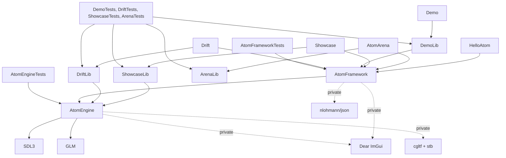
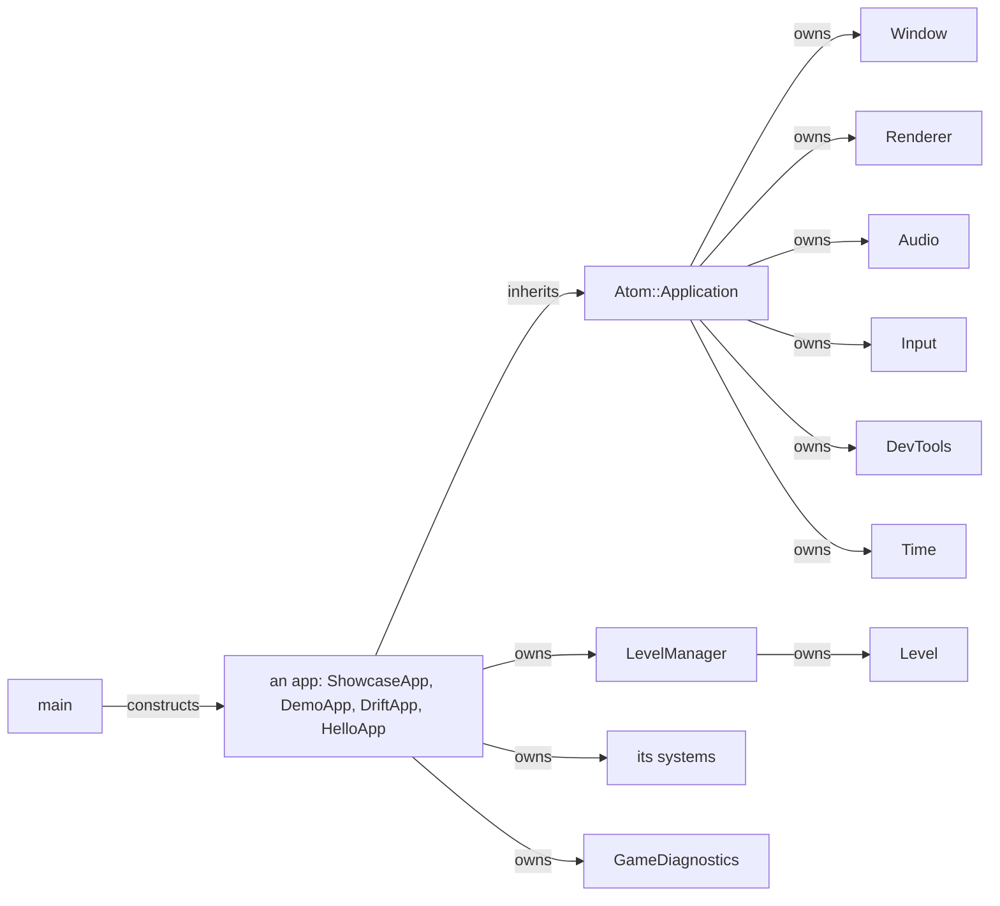
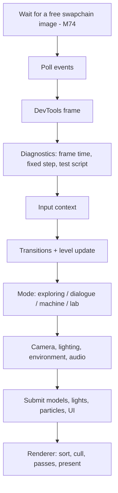
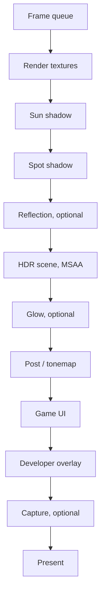
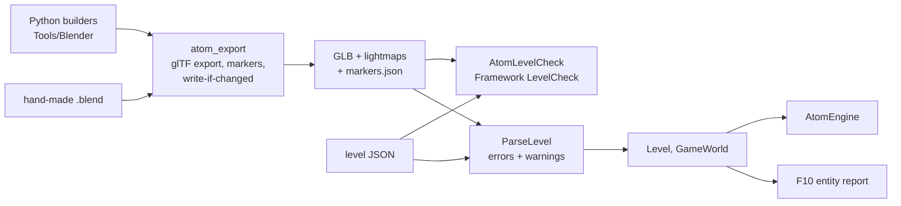
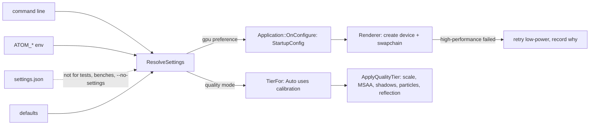
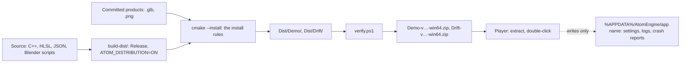

# AtomEngine — Architecture

How AtomEngine is put together, and the rules that keep it that way. The
[technical manual](AtomEngine-Tech-Manual.md) explains *concepts*; this page
explains *structure*. It is maintained (M58):
when a change alters a diagram or a rule here, the change updates this page.

## 1. Targets and dependency direction

Since v0.0.14 the repository has three layers; since v0.0.16 the apps
live under `Apps/`, by purpose:

```text
Engine/      AtomEngine     (namespace Atom)           window, GPU renderer, audio, input, physics, UI drawing, dev tools host
Framework/   AtomFramework  (namespace AtomFramework)  levels, world, player, environments, UI kit and menus,
                                                       settings, diagnostics, F10 panels, the scenario harness
Apps/Showcase/              ShowcaseLib + Showcase      the engine's front door: a lakeside village and the lens
Apps/Games/Demo/            DemoLib + Demo              the demo: a night street, its story
Apps/Games/Drift/           DriftLib + Drift            DRIFT, a port of a three.js game
Apps/Samples/HelloAtom/     HelloAtom                   the smallest app (docs/Getting-Started.md)
Apps/Benchmarks/AtomArena/  ArenaLib + AtomArena        a seeded benchmark: controlled workloads, measured
```

**Apps by purpose (v0.0.16).** The folders under `Apps/` say what each
app is for; they are conventions, not engine categories, and playing an
app doesn't place it.

| Category | Primary purpose | What decides it |
|---|---|---|
| Games | a complete product for players | its own rules, progression, settings and package |
| Samples | teach how to use the engine | small and focused enough to read and adapt |
| Showcase | present the engine to evaluators | visual presentation, exploration, explanations of each feature |
| Benchmarks | measure controlled workloads | reproducibility: seeds, workload switches, reports |

The demo stays a Game: its story, its pachinko machine and its package
define it. ATOM ARENA is a Benchmark: it is played, but measuring is what
it is for. Each app owns its `Assets/`, `Tests/` and `Scenarios/`;
reusable assets go to `Content/`, reusable code to the engine or the
framework, developer utilities to `Tools/`.



- **The one rule that matters most:** a layer never includes the one above
  it. The engine knows nothing of levels or players; the framework names no
  app; apps never link each other (ADR-007). What only an app has comes in
  through interfaces (`SoundLibrary`, `ScreenFactory`, `TestHooks`).
- **The framework** (M76, grown in v0.0.14): the run log, settings
  (`GameSettings`, `SettingsStore`), the calibration decision and the
  `--diagnostics` report; since M85 the world layer moved from the demo -
  data-driven levels, the entity world, interaction, environments, the
  character and the scenario harness; since M89-M91 the UI every app shares
  (`DevPanels` for F10, `UiKit`, `MenuScreen`, `SettingsScreen`) and
  `BasicTestHooks`.
- **The Showcase** (v0.0.14) is the engine's front door, built only from the
  engine and the framework. Each capability it shows is a *Feature* in its
  catalog (`Apps/Showcase/Features/`) with a source file, a manual section, a
  switch and a cost (ADR-009, `docs/Features.md`).
- **The games** (`Apps/Games/Demo`, `Apps/Games/Drift`) are products with their own
  packages. **The sample** (`Apps/Samples/HelloAtom`) is the proof that an app
  can be built from the two lower layers alone; CI compiles it. **The
  benchmark** (`Apps/Benchmarks/AtomArena`, v0.0.15) runs seeded workloads
  and reports what they cost; its simulation (`ArenaLib`) is pure and
  unit-tested.
- **Content** shared by several apps (the kit, the sky, fonts, environment
  presets, the first-render stage) lives in `Content/`; an app's own in its
  `Assets/`. `AssetRoots` looks a path up in the app's folder first.
- **Static libraries** let the tests exercise exactly the code the
  executables run.
- **Usage requirements are honest** (M54): PUBLIC only for what a target's
  headers expose (SDL types, GLM maths and its settings); PRIVATE for what
  only its `.cpp` files use (ImGui, JSON, cgltf, stb, the version string).
- **Build options:** `ATOM_BUILD_GAME` (the apps' shaders, needs `dxc`),
  `ATOM_BUILD_TESTS`, `ATOM_BUILD_PRESENTATION_PROBE`. CI builds with the
  game off, the unit tests and HelloAtom (§11).

## 2. Application, engine and app: the real layering

There is **no runtime `Engine` object**, and none should be added.



- **`Atom::Application`** is the engine's runtime: the platform loop, the
  owner of every process-lifetime subsystem (window, renderer, audio,
  input, developer tools, time) and the composition root that creates them
  in order. It is not a service locator: there is no global lookup.
- **An app** derives from `Application`, receives its hooks
  (`OnConfigure`, `OnInitialize`, `OnUpdate`, `OnShutdown`) and coordinates
  its systems in an explicit frame order. Measurement and scripted tests
  live beside it in `GameDiagnostics` (M57).
- Inheritance keeps the ownership order visible in one place. An `IGame`
  interface or a dependency-injection layer would add indirection without
  solving a present problem.

## 3. Lifecycles

**Start:** `OnConfigure` (settings resolved, adapter chosen - §8) → SDL
video → window → GPU renderer → audio (optional) → ImGui →
the app's `OnInitialize` (asset roots, sound library, persistent GPU assets
and fonts, data libraries, the `LevelManager` and the first level,
diagnostics) → the renderer's prewarm: every pipeline variant and scene
target built, and the first frames drawn, while still loading (v0.0.15,
M98; `ATOM_PREWARM=0` skips it). A crash handler is installed by the
framework's `RunLog` before any of it (§9).

**Frame:**



**Shutdown** is the start in reverse: the app's `OnShutdown` releases levels,
game GPU objects and fonts; then the base shuts down ImGui, audio, the
renderer and its device, the window and SDL.

**Levels** own everything level-lifetime (world, collision, models, voices,
screens); persistent progress (flags, counters) lives above them in
`GameState`. A transition loads the next level *before* releasing the old
one, so shared models are reused.

## 4. Renderer

A concrete façade over SDL GPU: resource factory, frame queue and pass
orchestrator. The device itself is a `GPUDevice` the renderer owns:

```text
Application → Renderer (frames, passes, resources) → GPUDevice (device + presentation) → SDL GPU → D3D12
```

- **`GPUDevice`** owns the SDL device and the window it presents to: the
  adapter choice and the low-power fallback, the window claim, the
  swapchain's composition, present mode and frames in flight, uncapped
  presentation for measuring, and the lost-swapchain abandon path (§8).
  These are device and window concerns, not scene rendering, and they're
  what a future fullscreen, resize or device-recovery change would touch.
  There's no backend interface behind it: SDL is that abstraction
  (ADR-001).
- **`Render()`** stays the frame coordinator: render textures, shadows,
  reflection, scene, glow, post, UI, capture, present.



- **Immediate submission:** each frame the game pushes references (meshes,
  materials, chunks, lights, particles); `Render()` sorts, culls, draws and
  clears the queue. The renderer never walks the game's world, and keeps no
  second copy of it. Protect this boundary.
- **Pipelines** are created lazily per variant (samples, culling, alpha to
  coverage, skinning, rain - M52).
- **Known pressure:** `Renderer.cpp` holds every pass. The plan is to move
  one pass's state and code into a private helper *when that pass next
  changes* (audit RENDER-001) - not a render graph, not an RHI.

## 5. GPU resource lifetime

`Mesh` and `Texture` free their SDL resources through a raw, non-owning
device pointer; `RenderTexture` unregisters through a raw `Renderer*`.

**Rule: every GPU wrapper must be destroyed before the renderer shuts
down.** It is checked, not just documented (M53): wrappers count themselves
in `GpuResources`, and `Renderer::Shutdown` reports anything still alive
(and any registered render texture) before destroying the device - and
asserts in Debug. Scenarios fail on that report.

Ownership stays unique (`unique_ptr` by the semantic owner; `shared_ptr`
only for models shared through `ModelCache`).

## 6. World

There is no general engine scene. A `Level` owns a `GameWorld`: a slot map
of entities - a name and transform plus optional capabilities (renderable,
interactable, animated, animator) - addressed by generation-checked
handles. Bulk static geometry is model parts and chunks, not entities.
Keep it that way; it is not an ECS and doesn't need to be (ADR-003).

## 7. Assets: source and product

| Kind | Where | Made by |
|---|---|---|
| **Source** | `Tools/Blender/*.py`, hand-made `<app>/Source/*.blend` (v0.0.17), hand-written JSON (levels, dialogue, presets, data), third-party `.glb` with their licence | people |
| **Intermediate** | `build/bake_cache/` (lightmap fingerprints), `--gpu` preview lightmaps | the Blender build (not committed) |
| **Product** | `<app>/Assets/**` and `Content/**`: `*.glb`, `*.png`, `*.markers.json` (committed, with a `_generated` note where JSON); DXIL (`build/…/shaders`) | Blender, headless and deterministic (`build_assets.py`, `export_scene.py`); `dxc` |
| **Runtime payload** | each app's declared folders (`atom_app_payload`, M108) | copied into `build/bin/<config>/<app>/` |
| **Distribution payload** | `Dist/<Game>/` | `cmake --install` (§9) |
| **CPU / GPU representation** | parsed level, model, material data; meshes and textures | the loaders, synchronously |

**Authoring (v0.0.17).** One authority per fact: the Python builders or a
hand-made `.blend` for geometry and markers, the level file for what
entities are and do; generated files are never edited
([Authoring.md](Authoring.md)).



The parser (`Framework/Level/LevelData.cpp`) is the one authority on what
a level file may say. `LevelCheck` adds what needs other files (models,
clips, other levels), and the content tests, `AtomLevelCheck` and the
export all call it (ADR-012).

Loading is synchronous and fused (`Model::Load` parses, decodes and
uploads); every level load logs its time and where it went (M57). Split CPU
from GPU loading only when a measured hitch or a tool needs it.

**What a player's machine needs (M66).** A git submodule is not a
runtime dependency; most of them disappear into the executable:

| Class | What | Reaches the player as |
|---|---|---|
| **Compile-time only** | GLM, nlohmann/json, cgltf, stb (headers or compiled-in sources), Dear ImGui (a static library), the MSVC C++ runtime (linked statically) | code inside each app's executable |
| **Runtime library** | SDL3 | `SDL3.dll`, the only DLL shipped |
| **Operating system** | Direct3D 12, DXGI, Win32 (kernel32, user32, gdi32, shell32, winmm, imm32, ole32, …) | already on Windows 10/11 |
| **Runtime asset** | the shipped asset folders, DXIL shaders | files beside the executable |
| **Authoring tool** | Blender and `Tools/Blender`, Python, `dxc` | nothing: their products are committed or built |
| **Development tool** | CMake, Visual Studio, doctest, `PresentationProbe`, `SwapchainMatrix`, `Tools/Perf`, `Tools/Dev`, PIX / RenderDoc | nothing |
| **Distribution metadata** | `LICENSE.txt`, the third-party notices (MIT, zlib, OFL) | text files in the package |

The C++ runtime used to be a DLL dependency (`VCRUNTIME140`, `MSVCP140`,
and the `api-ms-win-crt-*` set) that a PC without the Visual C++
Redistributable doesn't have. Since M66 every target links it statically
(`CMAKE_MSVC_RUNTIME_LIBRARY`, set before the first target so nothing mixes
runtimes), SDL3.dll included.

**In a development build (M108)** each app runs from a folder of its own,
`build/bin/<config>/<app>/`: its executable, `SDL3.dll`, the engine's
shaders and the asset folders its `CMakeLists.txt` declares
(`atom_app_payload`, `cmake/AtomApps.cmake`) - the same shape as its
package. Before, every app shared `build/bin/<config>/`, and a folder one
app copied there could hide one another app forgot to declare until the
package check. The test executables stay in `build/bin/<config>/`.

## 8. Hardware and settings

Two decisions are kept apart: **which adapter** (a stability choice, made
once before the device exists) and **how much to draw** (a quality tier,
applied live). Mixing them was the trap: "the fast GPU" is not "high
quality", and on a hybrid laptop it can be the unstable one.



- **Precedence:** command line > `ATOM_*` > saved file > defaults
  (`low-power`, `High`). All of it is pure (`Game/Settings/`) and
  unit-tested; a bad file yields the defaults.
- **Before the device:** `Application::OnConfigure()` lets the game fill a
  `StartupConfig` before the renderer exists - the only point where the
  adapter can be chosen. Changing it later means a restart; there is no
  in-process device rebuild.
- **Tiers cap, they don't force:** a tier only turns existing switches off
  (the reflection stays a level's choice under High). No renderer feature
  exists for one tier only.
- **Failure:** at start-up two steps can fail separately - creating the
  device (which picks the adapter) and claiming the window (which creates
  the swapchain). On the development laptop the RTX device is created and
  only its swapchain for the built-in panel is refused. Either way,
  high-performance falls back to low-power before any resource exists,
  and `StartupFallback` records the stage, adapter and error. Mid-run, a lost swapchain calls
  `OnRenderFailure`; the game saves a low-power fallback, and the device is
  *abandoned*, not destroyed - releasing it on that path corrupted SDL's
  heap - and the process exits with code 3.
- **Calibration** is a measured run over fixed views; its decision
  (`DecideCalibration`) is pure. Records carry the adapter and resolution
  and are dropped when those change.
- **Frames in flight: 2, and the swapchain wait before input (M74),**
  decided on measured input latency. Click to display (PresentMon, 144 Hz
  panel, Iris Xe): 3 frames 36 ms, 2 frames 30 ms, 2 frames with the wait
  moved before input 24 ms, all at 144 fps. In SDL's D3D12 backend the
  frames-in-flight limit also sizes the swapchain (`SDL_gpu_d3d12.c`).
  v0.0.10 chose 3 because 2 then ran at ~72 fps with vsync, under an older
  Intel driver. So, with vsync and the default 2, the renderer checks the
  frame interval once after a warm-up and moves to 3 if 2 can't hold the
  refresh (`NeedsThirdFrame`). `ATOM_FRAMES_IN_FLIGHT` and
  `ATOM_LATENCY_WAIT=late` override; calibration measures at the player's
  setting. Latency is measured by `Tools/Perf/latency.ps1`: the engine's
  stages unprivileged, PresentMon end to end.

## 9. Distribution

AtomEngine manufactures a standalone game: a ZIP a player extracts and
double-clicks, with no repository, compiler, Python or Blender involved.



- **One definition of what ships:** the install rules in
  `Game/CMakeLists.txt` (M68). They install the executable, `SDL3.dll`,
  the shaders, the shipped asset folders (`ATOM_SHIPPED_ASSETS`; the
  development-only `ATOM_DEV_ASSETS` stay out), the licences, and a
  players' README. `verify.ps1` reads its expectations from those same
  lists. What the machine needs at runtime is §7's table.
- **Paths:** assets and shaders resolve from the executable's folder
  (`SDL_GetBasePath`), never the working directory or the repository;
  `ATOM_ASSET_ROOT` is an explicit development opt-in.
- **Ownership:** the package is read-only. Everything a run writes goes
  to the per-user folder: settings, calibration, logs (§8, M67).
- **Two builds from one source:** `build/` for development (console,
  Debug and Release, tests) and `build-dist/` for players (windowed,
  Release, no tests). They differ only in `ATOM_DISTRIBUTION`.
- **Checked:** locally by `Tools/Dist/package.ps1`, which also starts the
  package from outside the repository, and on pull requests and pushes to
  master by CI's `package` job (M69), a check that keeps no ZIP. A release
  candidate is also tried on a clean Windows VM (a local procedure).

**What ships, and how (M70, revised in M82).** The player keeps what helps a
stranger report a problem; every developer facility is compiled out.

| Facility | Policy |
|---|---|
| The log file, `--diagnostics`, the start-failure message box | **always available** |
| Crash reports (a minidump and a text report, v0.0.15) | **always available**, written to the per-user folder (ADR-011) |
| The `.pdb` symbols of a Release build | **not packaged**: kept in the developer's build folder to read dumps (ADR-011) |
| F10 developer panels, the shared F1 overlay (every game) | **development only**: compiled out (`ATOM_DEV_TOOLS=0`) |
| The demo's F2–F8 display toggles | **shipped**: plain game keys |
| `ATOM_*` switches, the scenario harness (`ATOM_TEST_SCRIPT`), `bench`, `screenshot`, PERF and LAT logs, DRIFT's autopilot | **development only**: `Atom::DevSwitch` reads nothing in a package |
| Hot reload (`ATOM_ASSET_ROOT`) | **development only**: needs the source tree |
| Asserts, the D3D12 debug layer | **Debug only**: compiled out of Release |
| The character lab (`Lab/`, `ThirdParty/`, its level) | **not packaged**: its character's licence isn't recorded |
| `Tests/`, `PresentationProbe`, `SwapchainMatrix`, `Tools/Perf`, `Tools/Dev`, Blender tools, schemas | **not packaged** |

M82 reverses M70's "nothing stripped": `-DATOM_DISTRIBUTION=ON` also defines
`ATOM_DEV_TOOLS=0`. The cost is that the shipped executable is not byte for
byte the tested one; the switch gates only entry points (environment reads,
ImGui start-up), so game code paths are the same. The log says which:
"Developer tools: off (distribution build)", and `package.ps1` refuses a
package that says "on".

## 10. Tools

- **Runtime:** Dear ImGui panels (F10) and the F1 overlay (M82: shared by every game, engine lines first, then the game's) - an overlay, not
  an editor framework, and kept out of captures.
- **Scripted:** `.atomtest` scenarios, paired benches, captures - compiled
  in, switched on by the environment.
- **Offline:** Blender scripts (`export.ps1`: one unit or only markers; the
  AtomEngine marker panel, `open.ps1`), `AtomLevelCheck` (levels checked
  without the game), documentation captures, `ab.ps1`.
- **Inspecting (v0.0.17):** F10 > Level, the entity report - read-only,
  selection by name resolved every frame (`EntityInspector`).
- **External:** PIX, Intel GPA, RenderDoc for per-pass GPU timing (SDL GPU
  has no GPU timers).

## 11. Verification layers

| Layer | Runs where | Catches |
|---|---|---|
| CPU tests (`ctest -L cpu`), one target per owner: `Unit.<owner>`, `Content.<owner>` | locally and in **CI** on pull requests and pushes to master | logic, parsing, shipped-content errors; a clean clone that doesn't build |
| In-game scenarios (`ctest -L scenario`), each app's own: `Scenario.<owner>.<name>`; `-L smoke` one short run per app | locally (needs a GPU) | gameplay, rendering, transitions, leaks of voices and GPU resources |

`check.ps1 -Level changed` (v0.0.16) maps each changed file to owners
(`Tools/Dev/changed.psd1`) and builds and runs only theirs: an app's
change runs that app's tests and scenarios and compiles nothing of the
engine's; an engine or framework change runs their tests and every app's
smoke scenario. The whole matrix runs once per version (`-Level full`).
| Paired benches, `ab.ps1` | locally, plugged in | performance changes - never a CI gate |

## 12. Architecture decision records

### ADR-001 — SDL3 GPU is the renderer abstraction
**Decision:** use SDL GPU types directly; no internal RHI. **Why:** SDL GPU
already owns backend selection; a layer on top would map one to one.
**Revisit when** a needed API or platform can't be served through SDL GPU.

### ADR-002 — Static engine/game composition
**Decision:** ordinary CMake targets and static links; no plugins, Gems or
dynamic modules. **Revisit when** features must be distributed or loaded
without relinking.

### ADR-003 — Keep the slot-map world
**Decision:** `GameWorld` with optional capabilities; add small indices only
where profiling asks. **Revisit when** entity or query counts make iteration
measurably expensive.

### ADR-004 — Committed GLB/PNG are runtime products
**Decision:** commit deterministic products, so a clone runs without
Blender; the bake cache and GPU-tuning bakes are never shipped truth.
**Revisit when** product size or content merge conflicts become a measured
problem.

### ADR-005 — New libraries need a trigger
**Decision:** no migration by default. Each adoption needs a written unmet
capability, a baseline, a prototype and a rollback path. **Revisit** per the
table below, never as a bundle.

### ADR-006 — Low-power by default; the GPU choice is not a quality setting
**Context:** every release up to 0.0.9 hardcoded the low-power adapter -
on the development hybrid laptop (Iris Xe + RTX 4060) moving the window
between displays wired to different GPUs lost the swapchain. Measured in
0.0.10: there, Direct3D 12 refuses a swapchain on the RTX for the built-in
panel (`DXGI_ERROR_DEVICE_REMOVED`, also in a raw D3D12 probe), while the
RTX presents to an external monitor wired to it. **Decision:** keep
`low-power` the default; offer `high-performance` as a preference that
falls back to low-power at creation and, after a mid-run loss, on the next
launch. Quality is a separate tier, defaulting to `High` (0.0.9's look).
Calibration is opt-in. **Rejected:** scoring GPUs by name, a hardware
database, continuous adaptive quality, changing the power plan, rebuilding
the device in-process, a launcher. **Revisit when** a device rebuild is
needed for something else (then a live adapter switch costs little), or
when the default adapter proves wrong on hardware other than hybrid
laptops.

**Addendum (after 0.0.10): the RTX can't present to the panel at all.**
On the development laptop (HP, muxless Optimus: the panel is wired to
the Iris Xe only), no program can put an RTX image on the built-in panel
through Windows' hybrid path. Each possible cause was ruled out in turn
(`Tools/PresentationProbe/SwapchainMatrix.cpp` reproduces it):

| Ruled out | Evidence |
|---|---|
| AtomEngine's code | a raw D3D12 probe, without SDL, fails the same way |
| SDL | 3.4.16 and 3.4.18 alike; SDL's error says "success (0x00000000)", the probe gets `0x887A0005` |
| The swapchain kind | flip discard and sequential, bitblt, 2 or 3 buffers, BGRA or RGBA: all fail on the RTX, all work on the Iris |
| The API | D3D11 fails too when the RTX is chosen explicitly |
| NVIDIA's opt-ins | the `NvOptimusEnablement` export, and a per-program NVIDIA profile: no effect on D3D12 |
| The launching session | the same from the user's own terminal |
| The Intel driver | 32.0.101.6790 → 7092 (the newest for this chip; Intel's main driver no longer lists it): no change |

A D3D11 game (*The Evil Within*) does render on the RTX and show on the
panel, through NVIDIA's older per-game Optimus path, which D3D12 lacks.
So this is the laptop's hybrid-display stack, not something an engine
can work around. It confirms the decision: low-power by default,
high-performance as an opt-in that falls back and says which step failed
(`GPUDevice`, §4). On this machine the RTX is testable on an external
monitor wired to it.

### ADR-007 — Games share a framework, not each other's code
**Context:** v0.0.13 adds a second game, DRIFT, beside the demo. Both
need a log per run, a command line, settings resolution, diagnostics,
packaging - none of it rendering, so none of it the engine's. **Decision:**
a third layer, `AtomFramework`, between the engine and the games; each
game is its own library and executable, and no game links another.
What a game needs that is engine-shaped (toon shading, outlines, a synth)
goes into the engine in general form, never as "DRIFT mode". **Rejected:**
DRIFT as a level of the demo (it would inherit the demo's player,
interaction and settings, none of which it wants); copying the demo's
platform code (two diverging copies). **Revisit when** a third game needs
something both have and the framework doesn't, or the framework starts
holding one game's policy.

### ADR-008 — Packages carry no developer tools
**Context:** M70 shipped everything ("nothing stripped"): F10 panels, the
F1 overlay, every `ATOM_*` switch, inert unless used. With two games the
facilities were uneven, and a player could reach tools meant for
development. **Decision (M82):** a distribution build defines
`ATOM_DEV_TOOLS=0`; `Atom::DevSwitch` reads no environment and ImGui never
starts. Players keep the log, the start-failure box and `--diagnostics`.
`package.ps1` refuses a package whose run says "Developer tools: on".
**Cost:** the package is not byte for byte the tested build; the switch
gates entry points only, so game code paths are the same. **Revisit when**
a player-facing diagnostic needs a developer facility.

### ADR-009 — A capability enters the engine as a Feature, with a test and a measurement
**Context:** by v0.0.13 the engine's capabilities were scattered across the
demo's levels, and the first Showcase (M86) was a collage of them: nothing
said what each one was, what it cost, or where to read about it. **Decision
(v0.0.14):** each capability the engine offers is a *Feature* in the
Showcase's catalog (`Apps/Showcase/Features/Features.cpp`): a stable id, the
system that produces it, its source file, its manual section, where it
lives in the village, a switch (the lens, Tab; `set feature_<id>`) and a
live cost (`Stat`). It is listed in `docs/Features.md` with its status,
limits and tests. Unit tests check that every Feature names a real source
file, a real manual heading and an entry in `docs/Features.md`; the
`showcase_lens` scenario switches each one off and checks its effect
leaves the frame. A new capability is done when it is in the place, in
the lens, in the catalog, tested and measured. **Rejected:** a menu of
per-feature demo rooms (navigation, not purpose); a feature list kept
only in the README (claims without evidence). **Revisit when** a
capability can't be shown in the village (an editor, a tool, a platform),
or the catalog outgrows one place.

### ADR-010 — CPU profiling: a minimal built-in tracer
**Context (v0.0.15):** nothing showed where CPU time goes inside a frame.
Following ADR-005, an external profiler was evaluated against the existing
tools and a minimal built-in tracer on ATOM ARENA's deterministic
workloads, with the criteria fixed before measuring. **Decision:**
profiling zones are `ATOM_PROFILE_SCOPE` / `ATOM_PROFILE_FRAME`
(`Engine/Core/Profile.h`), compiled to nothing by default; `-DATOM_TRACE=ON`
records them with the engine's own tracer (`Engine/Core/Trace.h`: Perfetto
JSON, zone CSV, slowest frames), never in a distribution build.
**Evidence:** both had overhead below what the machine resolves at ~28
zones per frame; both found why the arena's grid collision was slower
than its all-pairs search (a sort taking 60 % of it; fixing it cut the
simulation by 22 %, state unchanged); the built-in tracer also answered
*when* the worst frames happen (the first frames: first-use pipeline and
resource creation) by script. **Rejected:** the external profiler as a
dependency now - it answered nothing better, cost a submodule and about an
hour of fragile tool-building, and its strengths (threads, live view,
sampling, memory, GPU) aren't needed by a single-threaded engine; a full
custom profiler (the tracer stays minimal: one thread, no live view).
**Revisit when** work runs on more than one thread, a problem needs live
inspection or sampling, or GPU timing becomes reachable - measured again
with ATOM ARENA.

### ADR-011 — Crash reports stay with the player
**Context (v0.0.15):** a player's crash left nothing: the process ended
and the log simply stopped. **Decision:** on an unhandled exception the
engine (`Engine/Platform/CrashReport.h`, installed by `RunLog`) writes a
minidump (`MiniDumpWriteDump`: threads, stacks and the memory they point
at) and a short text report (app, version, exception, module + offset) to
the per-user log folder, and ends the log with a line naming them. Nothing
is sent anywhere: the player chooses to send the files. Release builds
keep a `.pdb` in the build folder, never in a package (`verify.ps1`
rejects one); executables name it without the developer's folder. A
failed frame logs SDL's reason (D3D12's removal reason when the device was
lost), the adapter, the driver and memory. **Evidence:** a forced access
violation (M101, reverted) wrote both files; the report's offset resolved
to the faulting line with the build's `.pdb`. **Rejected:** a crash
reporting service or upload (a network dependency and a privacy question
for a learning engine); shipping symbols (size, and the source paths they
hold). **Revisit when** reports come from players at a volume that hand
collection can't handle, or work moves onto other threads (a dump then
needs every thread's state, which it already writes, but the report names
only the crashing one).

### ADR-012 — Level rules have one authority: the C++ parser
**Context (v0.0.17):** content is now checked in several places: the
level loader, the content tests, a command-line check an author or an
agent runs, the Blender export and the Blender panel. Each could grow its
own copy of "what a level may say", and the copies would drift.
**Decision:** `ParseLevel` (`Framework/Level/LevelData.cpp`) decides what
a level file may say: errors stop a load, warnings explain supported
surprises (a marker the file overrides). `LevelCheck`
(`Framework/Level/LevelCheck.h`) adds only what needs other files:
referenced models exist and are readable, clips exist on their models,
level changes land on a level and spawn, names are unique, no file comes
from another app. The content tests, `AtomLevelCheck` and `export.ps1`
all call it. The Blender panel checks only what Blender alone knows
(marker naming, markers against the level file's names) and leaves the
rest to `AtomLevelCheck`. **Evidence:** every shipped level passes; the
fixtures' mistakes each fail at their JSON Pointer; the check caught a
real override (the pachinko hall's prize counter) and a wrong export
folder during the pilot. **Rejected:** a Python validator in the export
(it would duplicate the parser); a separate schema-only check (JSON
Schema can't see other files). **Revisit when** a tool outside C++ needs
the full rules: then expose `AtomLevelCheck`'s output as JSON rather than
porting the rules.

## 13. When to add what

| Architecture or library | Not yet, because | Reconsider when |
|---|---|---|
| ECS | slot-map capabilities solve identity and composition | entity or query scale is measured as painful after small indices |
| Job system | the main thread meets current needs | profiles show independent workloads that standard facilities can't run |
| Custom RHI | SDL GPU is the abstraction (ADR-001) | a required API or platform is out of SDL GPU's reach |
| Render graph | the passes are few, fixed and readable | configurable topology, or repeated resource-hazard defects |
| Plugin / module system | one statically composed product | features must ship or load independently |
| Asset database | paths, schemas and committed products work | dependency tracking, moves or platform variants become a measured bottleneck |
| Async loading / CPU-GPU model split | level loads take ~0.2 s and have no budget | a measured load misses a stated budget, or a headless tool needs models |
| fastgltf | cgltf loads every shipped feature | parse time, diagnostics or an unsupported glTF feature fails a requirement |
| meshoptimizer / gltfpack | no size, load or vertex bottleneck is proven | representative assets miss a measured budget |
| Jolt Physics | 3D needs are static queries; 2D pachinko physics is its own | dynamic 3D bodies, constraints, ragdolls or vehicles enter scope |
| miniaudio | the SDL mixer covers synthesis, WAV, 3D, reverb, capture | streaming, codecs or complex routing exceed it |
| Scripting | data and C++ iteration suffice | non-programmers need runtime behaviour iteration |
| Reflection | parsers and schemas are explicit | many types need shared serialization or editor inspection |
| Custom allocator | no allocation problem measured | profiling shows contention or fragmentation |

**Rejected now:** an ECS framework, plugins, an RHI, a render graph, a
reflection system, dependency injection or a service locator, an event bus,
a job system or custom allocators, scripting, an asset daemon, an editor
framework around ImGui, splitting every engine folder into a library, and
library migrations without their trigger.
