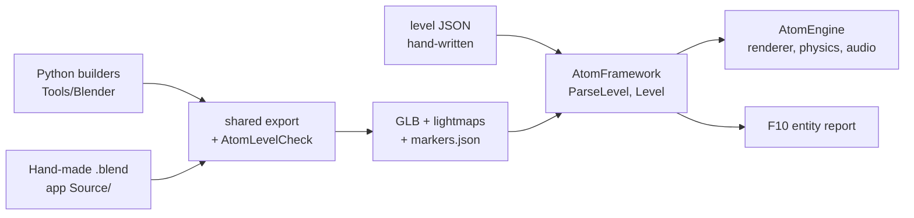

# Authoring content

How a level is made, which file says what, and who may edit it. For the
concepts behind each step, see the [technical manual](AtomEngine-Tech-Manual.md);
for where the pieces live, see [Architecture](Architecture.md).

## Three ways to work (v0.0.17)

Each works the same with or without an AI agent: every step is a
command, and every check prints where the problem is.

**A. Procedural content** (Python builders, JSON):
1. Edit the builder (`Tools/Blender/atom_*.py`) or the level file
   (`<app>/Assets/Levels/<level>.json`).
2. Export only that unit: `pwsh Tools/Blender/export.ps1 -Only <unit>`, or
   `-What markers` when only markers moved. Unchanged outputs aren't
   rewritten, and lightmaps re-bake only if their inputs changed.
3. `export.ps1` runs `AtomLevelCheck`; `git status` shows exactly what
   changed.
4. Run the level: `pwsh Tools/Dev/check.ps1 -Level changed`, or start it
   with `ATOM_START_LEVEL=<level>`.

**B. A level made by hand** (a `.blend`): open it with
`pwsh Tools/Blender/open.ps1 <scene.blend>`, model it and place markers with
the AtomEngine panel, save, clean
(`pwsh Tools/Blender/clean_scene.ps1 <scene.blend>`), export
(`export.ps1 -Scene <scene.blend> -Level <level>`), run.

**C. Debugging a running level:** F10, then the Level panel. Filter,
select an entity, and read where it came from and what it does; draw its
bounds. Problems the loader warns about are listed there, with their JSON
Pointer.

## The contract: one authority per fact

Every fact about a level has exactly one file that decides it. Anything
else holding the same fact is generated from that file, and says so.

| Fact | Authority (edit this) | Generated from it (never edit) |
|---|---|---|
| Procedural geometry, collision, lighting bakes | the Python builders in `Tools/Blender/` (`atom_kit.py`, `atom_levels.py`, `atom_street.py`, ...) | `*.glb`, `*_col.glb`, `*_lm.png` in an app's `Assets/` or `Content/` |
| Hand-made geometry (v0.0.17) | a `.blend` scene in the app's `Source/` folder | the same outputs, through the same export |
| Where spawns and entities stand | a Blender **marker** (`spawn:<name>`, `entity:<name>`) *or* the level file's `position` / `yaw` | `<level>.markers.json` (has `"_generated"`) |
| What an entity *is* and *does* (model, collider, interaction, animation, mover) | the level file, `<app>/Assets/Levels/<level>.json` | nothing |
| Lighting, fog, sky, audio, sequences of a level | the level file | nothing |
| Environment presets | `Content/Environments/*.json` | nothing |
| A level's sky picture | the level file's `"sky"` (a PNG in a `Sky/` folder). F10 → Environment → Sky picture turns it off (a preset's gradient sky shows - a picture always covers it), tries any PNG dropped into `Content/Sky/` or `<app>/Assets/Sky/`, and copies the `"sky"` block | nothing (the panel saves nothing) |
| A pachinko machine | `Tools/Machines/*_layout.py` | `Assets/Machines/*.json` |
| A ride: the vehicle, speed, the rider's eye, when steering is allowed, a route per spawn (direction, end action, flag) | the level file's `"ride"` (the demo's `coast_road.json`) | nothing |
| The ride's road | its Blender builder (`atom_coast.py`): the centre line it builds the road along | the markers' `"ride_path"`; a `path` in the level file wins, with a warning |
| A conversation, and whose voice mumbles it | the demo's `Assets/Dialogue/<id>.json` (`"voice"`, per dialogue or per node) | nothing |
| What a voice sounds like (`old_man`, `sinister`, `man`) | the demo's `Assets/Data/voices.json`: pitch and its spread, glide, waveform, syllable length, letters per syllable, breath, low-pass, echo - hot-reloaded | nothing |
| External models (third-party GLB) | the file as received, with its licence beside it | nothing |
| The rules every data file follows | `Framework/Schemas/*.schema.json`, an app's `Assets/Schemas/` - and, above them, the C++ parser (`Framework/Level/LevelData.cpp`) | nothing |

Where they live:

| Kind | Where | Committed |
|---|---|---|
| Source assets (Python builders, `.blend`, level JSON, third-party GLB) | `Tools/Blender/`, `<app>/Source/`, `<app>/Assets/Levels/`, `<app>/Assets/ThirdParty/` | yes |
| Generated runtime assets (GLB, lightmaps, markers) | `<app>/Assets/<folder>/`, `Content/<folder>/` | yes: CPU-baked, byte-identical on rebuild |
| Bake cache and previews | `build/bake_cache/` (fingerprints); `--gpu` lightmaps | no (GPU bakes must be redone on the CPU before a commit; a test refuses them) |
| Each app's runtime copy | `build/bin/<config>/<app>/Assets/` | no |
| Distribution payload | `Dist/<Game>/` | no |



## Placement: marker or level file

A spawn or an entity can be placed in two ways:

- **By a marker**: an empty in Blender named `spawn:<name>` or
  `entity:<name>`, or carrying the `atom_marker_kind` / `atom_marker_name`
  properties that the builders' `add_marker` sets. The export writes it to
  `<level>.markers.json`, in game coordinates (x, z, -y).
- **In the level file**: a `position` (and `yaw`) written on the spawn or
  the entity.

When both exist, **the level file wins**. That has been the rule since
M20, and it stays: a value written by hand is a decision. Since v0.0.17
the level also *says so*: each overridden marker is a warning naming the
JSON Pointer of the value that wins and the marker it hides. Moving the
marker in Blender would change nothing until that value is removed.

| Level file | Marker | Result | Reported |
|---|---|---|---|
| `position` | none | the file's | - |
| none | `entity:<name>` | the marker's | - |
| `position` | `entity:<name>` | the file's | warning at `/entities/<i>/position` |
| `yaw` only | `entity:<name>` | the marker's position, the file's yaw | warning at `/entities/<i>/yaw` |
| none | none, but the level has markers | - | **error**: no position and no marker |
| none | none, and no markers file | the origin | warning if the entity has a model or collider |
| - | `entity:<name>` with no such entity | - | **error** in `<level>.markers.json` |

Errors stop the level from loading, and the content tests fail. Warnings
let it load: they explain behaviour that is supported but easy to miss.
Every loaded entity and spawn keeps where its position came from
(`PlacementSource`: file, marker, or file with the marker ignored).

## Checking a level: `AtomLevelCheck`

One command checks an app's levels the way the app would load them, plus
what only shows across files, without starting the game (no window, no
GPU):

```powershell
build\bin\Debug\AtomLevelCheck.exe --app demo              # every level of an app
build\bin\Debug\AtomLevelCheck.exe --app showcase showcase # one level
build\bin\Debug\AtomLevelCheck.exe --all                   # every app
```

Options: `--errors-only`, and `--no-clips` (don't open the models, so
skip the clip and readability checks). For a folder outside the repository, use `--assets <dir> [--content <dir>]`.
The exit code is 0 when there are no errors (warnings are allowed), 1 on
errors and 2 on bad usage. Each problem names where to look:

```text
ERROR [broken]
  Entity: lamp
  Source: Levels/broken.json
  Property: /entities/0/model
  Problem: model "Kit/missing_lamp.glb" was not found
  Fix: check the path (relative to Assets/), or build it: Tools/Blender/export.ps1

WARNING [pachinko_hall]
  Entity: prize_counter
  Source: Levels/pachinko_hall.json
  Property: /entities/3/position
  Problem: the position written here overrides the entity:prize_counter marker; remove it to let the marker place it
```

What it checks:

| Check | Severity |
|---|---|
| everything the parser refuses: syntax with line and column, types, unknown actions, missing fields, a marker naming no entity, a sequence step naming no entity | error |
| the level's model, collision, lightmap, sky, chunk files, impostor descriptors, entity models, pachinko machines exist | error |
| each model is one the engine reads: glTF 2.0, with a mesh, without compressed geometry (the model is opened, without a GPU) | error |
| a file found only in **another app's** assets | error: an app reads only its own `Assets/` and the shared `Content/` |
| an animation clip that its model doesn't have (entity animation, animator states, `playAnimation`) - the model is opened | error, listing the clips it has |
| two entities with one name | error |
| a collider with a zero or negative size | error |
| `changeLevel` to a level the app doesn't have, or to a spawn that level doesn't have | error |
| the level file overriding a marker | warning |
| something drawn or solid left at the origin | warning |
| a position more than 10 km from the origin | warning |

The checks live in the framework (`Framework/Level/LevelCheck.h`), and
the parser stays the authority on what a level file may say. CTest runs
the tool for every app (`LevelCheck.<owner>`, labels `cpu` and `content`),
CI included, and the apps' content tests call the same code.

## Exporting from Blender: `export.ps1`

The procedural content is built and exported by `Tools/Blender/build_assets.py`,
running in Blender in the background (Blender 5.2 is what this repository's
outputs were made with; any 4.x or later with the glTF exporter should work).
Run it through `Tools/Blender/export.ps1`, which finds Blender (on `PATH`, in
`ATOM_BLENDER`, or the newest under `Program Files\Blender Foundation`),
exports, then runs `AtomLevelCheck`:

```powershell
pwsh Tools/Blender/export.ps1 -List                       # the units, and what each writes
pwsh Tools/Blender/export.ps1 -Only fields                # one level: its models, collision, bakes, markers
pwsh Tools/Blender/export.ps1 -Only fields -What markers  # only its markers.json - no bake, no model
pwsh Tools/Blender/export.ps1 -Only kit,street            # several units
pwsh Tools/Blender/export.ps1                             # everything
```

Options: `-What all|geometry|markers`, `-NoCache` (re-bake every lightmap),
`-Gpu` (lightmaps on the GPU: a preview, never committed; a test refuses
them), `-NoCheck`.

**Units.** A unit is what one builder makes:

| Unit | Outputs |
|---|---|
| `kit`, `sky` | `Content/Kit/*.glb`, `Content/Sky/night_sky.png` |
| `street`, `city`, `night` | the demo's street, city layers and night street |
| `shrine`, `interior`, `fields`, `pachinko`, `passage` | the demo's other levels |
| `first`, `lab`, `lakeshore` | the Showcase's stages and terrain (`first` goes to `Content/First`) |

**What stays the same.** Every output passes through a byte comparison
(`atom_export.write_if_changed`): a file whose content didn't change is not
rewritten, so `git status` shows exactly what an edit changed. JSON is
compared with line endings normalised (a checkout with `core.autocrlf` holds
it with CRLF). A unit exported alone gives the same bytes as the full
build: every unit is still *built* in memory (about a second), because
Blender's object and mesh names are global, and `.001` vs `.006` would
otherwise depend on what was built before.

| Export (warm lightmap cache, Blender 5.2) | Time |
|---|---|
| everything | about 37 s |
| one unit | 4-12 s |
| one level's markers | about 4 s (1.7 s of it is Blender starting) |

A changed lightmap still bakes for minutes (CPU path tracing); the bake
cache in `build/bake_cache/` skips any lightmap whose inputs are unchanged.

`pwsh Tools/Blender/test_export.ps1` checks these guarantees against the
real build. CTest runs it as `Blender.export` (label `blender`) where
Blender is installed.

## Inspecting a loaded level: F10's entity report

In a development build, F10 opens the developer panels. The **Level** panel
reports the level that is loaded:

- **warnings:** a count, if the level has any (`AtomLevelCheck` prints them in full);
- **filter:** a box that matches any part of an entity's name, in any case;
- **list:** each entity's name, position and capabilities (drawn, use, anim,
  animator, hidden). Click a row to inspect it.
- **details:** for the selected entity, its JSON Pointer in the level file,
  **where its position came from** (file, marker, or file with the marker
  ignored), its transform, model, collider, interaction (prompt, action,
  where to look and from how far, locked action, required flag), animation, animator, mover, style, and its
  live state (where it is now, shown or hidden, animating). The level's
  warnings about that entity are listed under it.
- **Show where it is:** draws the selected entity over the frame, even
  with the panel collapsed; the panel shows the legend:

  | Colour | Means |
  |---|---|
  | yellow box | the model's bounds: what is drawn |
  | cyan box | the collider: what blocks the player |
  | pink cross, line and circle | a point (no model, no collider); the circle is where the player looks to use it |

  Every drawn entity has a yellow box; a cyan box only if it has a collider. An entity
  with neither is drawn as a point: a cross at its position and a line to
  where the player must look to use it. Such an entity is often an
  interaction on something the level's own model draws, like the street's
  vending machines, so there is no box to fit.

The report only reads, and changes nothing. Its selection is the level's
name plus the entity's name, looked up again every frame: reloading the
level (hot reload) finds the entity again, and another level clears the
selection, so nothing it holds can outlive the level. Apps without levels
(DRIFT) don't get the panel. Packages have no F10 at all.

Scenarios can use it too: `set inspect <entity>` (or `none`) selects, and
`expect_stat inspect_found == 1` checks the selection resolves
(`Apps/Samples/HelloAtom/Scenarios/hello_inspect.atomtest`). In apps built
on `BasicTestHooks`, `set devtools on|off` shows or hides F10.

## Placing markers in Blender: the AtomEngine panel

```powershell
pwsh Tools/Blender/open.ps1 [scene.blend]
```

This opens Blender with an **AtomEngine** tab in the 3D view's sidebar (N).
The panel runs from the repository, using the export's own marker code
(`atom_export.make_marker`, the same function the level builders call), so
nothing is installed into Blender. In a running Blender you can instead
open `Tools/Blender/atom_markers_panel.py` in the Text Editor and choose
*Run Script*.

- **Level file:** the level JSON the markers belong to (relative to the
  repository), e.g. `Apps/Samples/HelloAtom/Assets/Levels/hello_room.json`.
- **Name**, then **Add spawn** or **Add entity:** adds the empty at the 3D
  cursor, named `spawn:<name>` or `entity:<name>`, with the real name also
  kept in properties (Blender renames an object whose name is taken).
  Move and turn it with Blender's own tools: only the turn about Z
  counts. A spawn looks along its arrow (game yaw = -rotation); an entity
  turns like a kit piece (yaw = rotation).
- **Selected marker:** its game position and yaw, as the export will write
  them, and the level file's entry for it: model, capabilities, and
  whether the file's `position` wins over the marker.
- **Check markers:** the export's rules (kind, name, unique in the level),
  plus the level file: a marker naming no entity (error), a marker the
  file overrides (warning), an entity or spawn with neither a position
  nor a marker (error).

`Tools/Blender/test_markers.py` (CTest `Blender.markers`) checks that
markers made by the panel export exactly like the builders' ones,
including their yaw, and that the checks find these problems.

## A level made by hand in Blender

The procedural levels are built by Python; a level can also be modelled by
hand in Blender's GUI. The example is HelloAtom's room:

| File | Role |
|---|---|
| `Apps/Samples/HelloAtom/Source/hello_room.blend` | **the source**: geometry and markers, edited in Blender |
| `Apps/Samples/HelloAtom/Assets/Levels/hello_room.json` | the level file, written by hand: what the entities are, the lighting, and where the models go |
| `Assets/Room/hello_room.glb`, `hello_room_col.glb`, `Levels/hello_room.markers.json` | generated by the export, never edited |

**The scene's conventions:**
- a collection **`Visual`**: what is drawn. Plain materials (a base colour) work; textures go through Blender's glTF exporter as usual.
- a collection **`Collision`**: what the player walks on and bumps into. Simple boxes are best; materials are dropped.
- **markers**: `spawn:<name>` and `entity:<name>` empties anywhere in the scene, made by hand or with the AtomEngine panel.
- anything else (cameras, lights, reference objects) is left out.

**Edit, export, run:**

```powershell
pwsh Tools/Blender/open.ps1 Apps/Samples/HelloAtom/Source/hello_room.blend   # edit; save in Blender
pwsh Tools/Blender/export.ps1 -Scene Apps/Samples/HelloAtom/Source/hello_room.blend -Level hello_room
cmake --build build --config Debug --target HelloAtom
$env:ATOM_START_LEVEL = "hello_room"; build\bin\Debug\HelloAtom\HelloAtom.exe
```

The export (`Tools/Blender/export_scene.py`) uses the same exporter
settings, marker conversion and write-if-changed as the procedural build
(`atom_export`). It writes the models exactly where the level file's
`model` and `collision` name them, so the two can't disagree. `-Bake sky`
(the default) or `-Bake ao` bakes vertex light into the meshes during the
export; the `.blend` itself is never saved by the export. Any generated
file names its source (`"_generated"`), and the export refuses to overwrite
a file another source made, such as a procedural level's markers. Then
`AtomLevelCheck` checks the levels.

`Scenario.hello.hello_room` starts in the room, and checks that the player
arrives at the spawn marker, the marker-placed entities are there, and the
floor holds. `test_export.ps1` checks that re-exporting the unchanged scene
writes nothing, and that a foreign file is refused.

**Before committing a `.blend`, clean it.** Blender saves its UI with a
scene: windows, screens, and the file browser's last folders, e.g.
`C:\Users\<you>\Documents`. In a public repository that is personal data,
and `Tools/Dev/privacy.ps1` can't see inside a compressed `.blend`. So:

```powershell
pwsh Tools/Blender/clean_scene.ps1 Apps/Samples/HelloAtom/Source/hello_room.blend
```

This keeps the scene data only (opened again, Blender shows its default
layout) and checks that no absolute path is left. `export.ps1 -Scene`
refuses a `.blend` that isn't clean, and `test_export.ps1` checks every
committed `.blend`.

**Why a binary file is the source here.** A `.blend` doesn't diff or
merge, and an agent can't edit it as text: that is the price of modelling
by hand. Keep such scenes small and self-made (no third-party content),
and keep everything that *can* be text - what entities are and do - in the
level file.

## External models (a GLB from another tool)

A model made elsewhere (Blender by hand, another DCC tool, a store) is used
as it is: the file is its own source.

1. **Licence first.** The repository is public under MIT: only content you
   made, or whose licence allows redistribution, with the licence and
   credit beside it (see `Apps/Showcase/Assets/ThirdParty/README.md`).
2. **Export it as glTF 2.0 binary** (`.glb`), metres, Y up (Blender's glTF
   exporter does this by default), with embedded or neighbouring PNG/JPEG
   textures.
3. **Put it in the app that uses it** (`<app>/Assets/<Folder>/`), or in
   `Content/<Folder>/` if several apps share it, and name it from a level
   file: `{ "name": "statue", "model": "Props/statue.glb", "position": [0, 0, -4] }`.
4. **Check:** `build\bin\Debug\AtomLevelCheck.exe --app <app>` opens the
   model and fails if the engine can't read it, or if a clip the level
   names isn't in it.

What the engine reads (`Engine/Assets/Model.cpp`, cgltf):

| Supported | Not supported |
|---|---|
| triangle meshes: positions, normals, `TEXCOORD_0`, `TEXCOORD_1` (lightmap UVs), `COLOR_0` (read as baked light) | compressed geometry (Draco, meshopt): such a file is refused |
| metallic-roughness materials: base colour (texture and factor), alpha mask or blend, double-sided, emissive texture, factor and strength; the `atom_fog` material extra | morph targets (shape keys): ignored |
| skins up to 255 joints, 4 weights per vertex | other material extensions (clearcoat, transmission, ...): ignored |
| animation clips: translation, rotation, scale; step, linear, cubic spline | cameras and lights in the file: ignored (the level file lights the scene) |

A store model rarely arrives at the right size or with the clips you want.
Fix both in the level file, not in the model: `"scale"` sizes it (measure
it first), `"yaw"` turns it, and a held frame of any clip poses it -
`"animation": { "clip": "<clip>", "autoplay": false, "time": <seconds> }`
draws the skin at that time and keeps it still. The Demo's shrine keeper
(`ThirdParty/old_man_psx.glb`, 3.3 m tall, its one clip a dance) is
`"scale": 0.5` and frame 0 of that dance.

A model without `COLOR_0` is drawn unbaked (white baked light), which is
right for something lit only live. Kit pieces get baked light from the
build (`atom_bake`); an external model gets it only if it was baked
before export.
