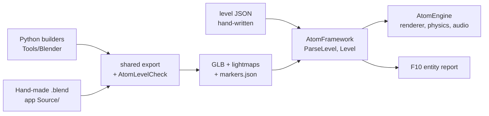

# Authoring content

How a level is made, which file says what, and who may edit it. For the
concepts behind each step, see the [technical manual](AtomEngine-Tech-Manual.md);
for where the pieces live, see [Architecture](Architecture.md).

## The contract: one authority per fact

Every fact about a level has exactly one file that decides it. Anything
else holding the same fact is generated from that file, and says so.

| Fact | Authority (edit this) | Generated from it (never edit) |
|---|---|---|
| Procedural geometry, collision, lighting bakes | the Python builders in `Tools/Blender/` (`atom_kit.py`, `atom_levels.py`, `atom_street.py`, ...) | `*.glb`, `*_col.glb`, `*_lm.png` in an app's `Assets/` or `Content/` |
| Hand-made geometry (v0.0.17) | a `.blend` scene in the app's `Source/` folder | the same outputs, through the same export |
| Where spawns and entities stand | a Blender **marker** (`spawn:<name>`, `entity:<name>`) *or* the level file's `position` / `yaw` | `<level>.markers.json` (has `"_generated"`) |
| What an entity *is* and *does* (model, collider, interaction, animation, mover) | the level file, `<app>/Assets/Levels/<level>.json` | nothing |
| Lighting, fog, sky, audio, sequences of a level | the level file | nothing |
| Environment presets | `Content/Environments/*.json` | nothing |
| A pachinko machine | `Tools/Machines/*_layout.py` | `Assets/Machines/*.json` |
| External models (third-party GLB) | the file as received, with its licence beside it | nothing |
| The rules every data file follows | `Framework/Schemas/*.schema.json`, an app's `Assets/Schemas/` - and, above them, the C++ parser (`Framework/Level/LevelData.cpp`) | nothing |

Where they live:

| Kind | Where | Committed |
|---|---|---|
| Source assets (Python builders, `.blend`, level JSON, third-party GLB) | `Tools/Blender/`, `<app>/Source/`, `<app>/Assets/Levels/`, `<app>/Assets/ThirdParty/` | yes |
| Generated runtime assets (GLB, lightmaps, markers) | `<app>/Assets/<folder>/`, `Content/<folder>/` | yes: CPU-baked, byte-identical on rebuild |
| Bake cache and previews | `build/bake_cache/` (fingerprints); `--gpu` lightmaps | no (GPU bakes must be redone on the CPU before a commit; a test refuses them) |
| Each app's runtime copy | `build/bin/<config>/<app>/Assets/` | no |
| Distribution payload | `Dist/<Game>/` | no |

## Placement: marker or level file

A spawn or an entity can be placed in two ways:

- **By a marker**: an empty in Blender named `spawn:<name>` or
  `entity:<name>`, or carrying the `atom_marker_kind` / `atom_marker_name`
  properties that the builders' `add_marker` sets. The export writes it to
  `<level>.markers.json`, in game coordinates (x, z, -y).
- **In the level file**: a `position` (and `yaw`) written on the spawn or
  the entity.

When both exist, **the level file wins**. That has been the rule since
M20, and it stays: a value written by hand is a decision. Since v0.0.17
the level also *says so*: each overridden marker is a warning naming the
JSON Pointer of the value that wins and the marker it hides. Moving the
marker in Blender would change nothing until that value is removed.

| Level file | Marker | Result | Reported |
|---|---|---|---|
| `position` | none | the file's | - |
| none | `entity:<name>` | the marker's | - |
| `position` | `entity:<name>` | the file's | warning at `/entities/<i>/position` |
| `yaw` only | `entity:<name>` | the marker's position, the file's yaw | warning at `/entities/<i>/yaw` |
| none | none, but the level has markers | - | **error**: no position and no marker |
| none | none, and no markers file | the origin | warning if the entity has a model or collider |
| - | `entity:<name>` with no such entity | - | **error** in `<level>.markers.json` |

Errors stop the level from loading, and the content tests fail. Warnings
let it load: they explain behaviour that is supported but easy to miss.
Every loaded entity and spawn keeps where its position came from
(`PlacementSource`: file, marker, or file with the marker ignored).
